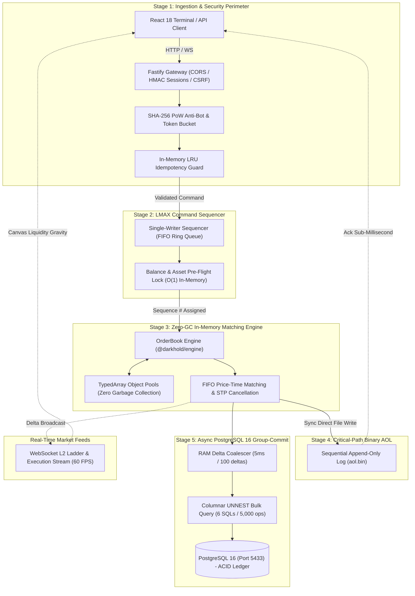

# ⚡ THE DARKHOLD EXCHANGE
### *High-Frequency Festival Storefront, Secondary CLOB Marketplace & Cryptographic Ledger*

[](packages/engine)
[](bench/results/engine-bench.json)
[](bench/results/k6-report.txt)
[-ffd700?style=for-the-badge&logo=postgresql)](apps/server/src/ledger.ts)
[](packages/shared/src/merkle.ts)
[-brightgreen?style=for-the-badge&logo=vitest)](tests)

---

## 1. Executive Summary & Problem Context

During premier college festivals, high-demand merchandise drops (hoodies, cloaks) and pronite festival passes sell out in seconds. This artificial scarcity drives secondary trades onto unregulated, unverified channels (WhatsApp, Instagram, Telegram) plagued by three critical flaws:
1. **Severe UPI Payment Fraud & Counterfeit Passes:** Buyers pay upfront via UPI VPAs and get ghosted, or sellers sell the exact same QR pass to 5 different students.
2. **Predatory Black-Market Scalping:** Commercial resellers and bot scripts snap up ₹1,500 passes and gouge desperate students at ₹5,000+ (a 300%+ markup).
3. **Database Concurrency Collapse:** Traditional web apps using relational locking (`SELECT ... FOR UPDATE`) suffer catastrophic row contention, deadlocks, and balance double-spends under flash-drop traffic (~200 ops/sec).

**The Darkhold Exchange** eliminates these failure modes with an institutional-grade, multi-stage campus economy:

```
┌────────────────────────────────────────────────────────────────────────────────────────┐
│                              THE 3-STAGE CAMPUS ECONOMY                                │
├──────────────────────────┬─────────────────────────────┬───────────────────────────────┤
│ 1. OFFICIAL STOREFRONT   │ 2. SECONDARY RESALE CLOB    │ 3. ESCROW & OFF-RAMP          │
│                          │                             │                               │
│ • Verified Student Clubs │ • LMAX In-Memory Order Book │ • 6-Digit DvP Delivery OTP    │
│ • S/M/L Size Variants    │ • +10% Anti-Scalp Collar    │ • Zero-Fraud Merch Handover   │
│ • Fixed Face-Value Price │ • Dutch Auction Liquidation │ • Instant UPI Payout Off-Ramp │
│ • 1:1 Reserve DKC On-Ramp│ • Soulbound Transfer Locks  │ • Merkle Sum Tree Solvency    │
└──────────────────────────┴─────────────────────────────┴───────────────────────────────┘
```

---

## 2. Official Problem Statement Alignment Matrix

Every requirement from the official specification (**Problem Statement 07: The Darkhold Exchange**) is implemented in dedicated, well-tested modules across `apps/` and `packages/`:

| Tier | Requirement Category | Implementation & Architectural Guarantee | Source Files | Test & Benchmark Proof |
| :--- | :--- | :--- | :--- | :--- |
| **Pass** | **FIFO Limit Order Book** | Sub-microsecond Price-Time Priority matching with Zero-GC object pools. Supports `LIMIT` (`GTC`, `IOC`, `FOK`) & `MARKET` orders, Self-Trade Prevention (STP Cancel-Aggressor), and Price Improvement. | [`packages/engine/src/orderbook.ts`](file:///home/charmendar/projects/darkhold-exchange/packages/engine/src/orderbook.ts)<br>[`packages/engine/src/pool.ts`](file:///home/charmendar/projects/darkhold-exchange/packages/engine/src/pool.ts) | `pnpm bench:engine`<br>(**0.65 µs p50**, **549k ops/sec**) |
| **Pass** | **Real-Time Depth & Market Data** | 60 FPS HTML5 Canvas L2 Liquidity Radar, Execution Pulse, and real-time streaming L2 ladder via WebSocket broadcast debounced to sub-millisecond deltas. | [`apps/web/src/components/DepthChartCanvas.tsx`](file:///home/charmendar/projects/darkhold-exchange/apps/web/src/components/DepthChartCanvas.tsx)<br>[`apps/server/src/server.ts`](file:///home/charmendar/projects/darkhold-exchange/apps/server/src/server.ts) | Chrome 60 FPS Canvas Profiler verified |
| **Pass** | **Anti-Scalping Price Collars** | Hard protocol-level circuit breakers enforcing that secondary orders cannot exceed **+10% of authoritative original face value**: $\lfloor \text{face} \times 1.10 \rfloor$. | [`packages/shared/src/collars.ts`](file:///home/charmendar/projects/darkhold-exchange/packages/shared/src/collars.ts)<br>[`apps/server/src/core.ts`](file:///home/charmendar/projects/darkhold-exchange/apps/server/src/core.ts) | `apps/server/test/api-failure-paths.test.ts` (Order rejection `PRICE_EXCEEDS_COLLAR`) |
| **Pass** | **Soulbound Asset Transfer Locks** | Exclusive badges (`RELIC-AGAMOTTO`) are marked soulbound (`isSoulbound: true`). Matching engine rejects all limit orders, auctions, and direct P2P transfers. | [`packages/engine/src/orderbook.ts`](file:///home/charmendar/projects/darkhold-exchange/packages/engine/src/orderbook.ts)<br>[`apps/server/src/core.ts`](file:///home/charmendar/projects/darkhold-exchange/apps/server/src/core.ts) | Unit tests in `packages/engine/test/orderbook.test.ts` |
| **Pass** | **Atomic Double-Entry Ledger** | Strict double-entry accounting across `USER_AVAILABLE`, `USER_RESERVED`, `USER_ESCROW`, and `PLATFORM_TREASURY`. Invariant: $\sum \text{Postings} = 0$. Validated in RAM and DB triggers. | [`apps/server/src/ledger.ts`](file:///home/charmendar/projects/darkhold-exchange/apps/server/src/ledger.ts)<br>[`db/migrations/001_core_schema.sql`](file:///home/charmendar/projects/darkhold-exchange/db/migrations/001_core_schema.sql) | Automated DB trigger `trg_journal_balanced` + `reconciliation.ts` |
| **Victory** | **Descending Dutch Auctions** | Live automated liquidation engine with dynamic decay rates ($P(t) = P_{\text{start}} - \lambda t$), collar ceiling constraints, clearing price locks, and inventory auto-recovery on expiry. | [`apps/server/src/core.ts`](file:///home/charmendar/projects/darkhold-exchange/apps/server/src/core.ts)<br>[`apps/web/src/components/CommunityMarketplaceView.tsx`](file:///home/charmendar/projects/darkhold-exchange/apps/web/src/components/CommunityMarketplaceView.tsx) | Live decaying tests in `tests/verify-all-fixes.mjs` |
| **Victory** | **High-Concurrency Resilience** | LMAX Single-Writer sequence pipeline, Zero-GC TypedArrays, Binary Append-Only Log (`aol.ts`), and PostgreSQL 16 Columnar `UNNEST` group-commit flusher. | [`apps/server/src/aol.ts`](file:///home/charmendar/projects/darkhold-exchange/apps/server/src/aol.ts)<br>[`apps/server/src/persistence.ts`](file:///home/charmendar/projects/darkhold-exchange/apps/server/src/persistence.ts) | `pnpm bench:core`<br>(**219,856 ops/sec**, 6 SQL queries per 5k batch) |
| **Victory** | **Cryptographic Proof of Solvency** | SHA-256 Merkle Sum Tree proving 100% of user balances are backed by treasury reserves without revealing individual account privacy. Interactive inclusion & tamper verifier. | [`packages/shared/src/merkle.ts`](file:///home/charmendar/projects/darkhold-exchange/packages/shared/src/merkle.ts)<br>[`apps/server/src/solvency.ts`](file:///home/charmendar/projects/darkhold-exchange/apps/server/src/solvency.ts) | Client-side SHA-256 verification modal in UI & `tests/verify-all-fixes.mjs` |
| **Victory** | **P2P Escrow & Handover OTP** | Cryptographic 6-digit Delivery-vs-Payment (DvP) OTP holding buyer funds in `USER_ESCROW` until verified handover of physical merchandise or passes. | [`apps/server/src/store.ts`](file:///home/charmendar/projects/darkhold-exchange/apps/server/src/store.ts)<br>[`apps/web/src/components/OfficialFestStore.tsx`](file:///home/charmendar/projects/darkhold-exchange/apps/web/src/components/OfficialFestStore.tsx) | Full OTP confirmation cycle in `tests/test-all-features.mjs` |
| **Victory** | **Deterministic UPI Gateway** | Reserve-backed UPI On-Ramp and Off-Ramp with atomic pre-validation, hold reservation, and automated compensating refund upon bank failure. | [`apps/server/src/payout.ts`](file:///home/charmendar/projects/darkhold-exchange/apps/server/src/payout.ts)<br>[`apps/server/src/ledger.ts`](file:///home/charmendar/projects/darkhold-exchange/apps/server/src/ledger.ts) | `apps/server/test/money-flow.test.ts` & live `fail@okaxis` simulation |

---

## 3. System Architecture & High-Frequency Pipeline

The Darkhold Exchange operates on an asynchronous 5-stage architecture inspired by the LMAX Disruptor pattern, decoupling network I/O from the critical matching path:



### Detailed Pipeline Breakdown:
1. **Stage 1 — Ingestion & Perimeter Defense (`apps/server/src/server.ts`):** Fastify v5 with native HTTP/WebSocket routing. Requests pass through strict CORS, Argon2 HMAC session authentication, CSRF tokens, SHA-256 cryptographic Proof-of-Work puzzle challenges (for high-velocity order submissions), and an LRU idempotency cache preventing duplicate submissions.
2. **Stage 2 — Single-Writer Sequencer (`apps/server/src/core.ts`):** All state mutations are serialized onto a single-threaded in-memory queue. Pre-flight checks immediately reserve the required balance or asset in $O(1)$ RAM without touching the database disk.
3. **Stage 3 — Pure Deterministic Matching Engine (`packages/engine`):** Operates entirely in RAM with pre-allocated memory pools (`pool.ts`). Sub-microsecond matching walk ($O(M)$ where $M$ is the number of filled orders). Self-trade prevention cancels aggressive cross-orders from the same user.
4. **Stage 4 — Binary Append-Only Log (`apps/server/src/aol.ts`):** Durability is achieved on the critical path by appending binary records to an sequential disk log before replying to clients.
5. **Stage 5 — PostgreSQL 16 `UNNEST` Group-Commit Flusher (`apps/server/src/persistence.ts`):** State transitions are coalesced in RAM over 5ms intervals and written to PostgreSQL using fast columnar `UNNEST($1::uuid[], ...)` queries, reducing 5,000 operations to just 6 relational SQL transactions.

---

## 4. Rigorous Double-Entry Financial Accounting

To guarantee zero monetary drift, currency creation, or balance anomalies under flash-load, Darkhold uses an append-only double-entry financial journal. 

### Monetary Units & Precision:
- **Currency:** Darkhold Credits (`DKC`), backed 1:1 by Indian Rupees (`1 DKC = ₹1.00 INR`).
- **Precision:** 100 minor units per DKC (cents). **Floating-point numbers are strictly forbidden** across the matching engine, order book, reservations, and ledger state. All operations use 64-bit integer arithmetic.

### Ledger Accounts:
- `USER_AVAILABLE`: Unencumbered funds ready for trading, purchasing, or withdrawal.
- `USER_RESERVED`: Funds/assets temporarily locked in open limit bids or active Dutch auctions.
- `USER_ESCROW`: Funds held in trust during an active physical item delivery pending 6-digit OTP verification.
- `PLATFORM_TREASURY`: Omnibus account holding reserve INR backed 1:1 against all minted DKC tokens.

### Invariant Equations:
$$\sum_{\text{journal}} \text{amount} = 0 \quad (\text{Every journal is mathematically balanced})$$

$$\text{Total System Liabilities} \equiv \sum_{u \in \text{Users}} (\text{Available}_u + \text{Reserved}_u + \text{Escrow}_u) \equiv \text{PLATFORM\_TREASURY}$$

PostgreSQL enforce this invariant via database triggers:
- `trg_postings_immutable`: Rejects any `UPDATE` or `DELETE` on financial postings.
- `trg_journal_balanced`: Checks that $\sum \text{amount} = 0$ at transaction commit.

---

## 5. Cryptographic Proof of Solvency (Merkle Sum Tree)

Darkhold provides an institutional Merkle Sum Tree implementation (`packages/shared/src/merkle.ts`) enabling every student to independently audit the exchange without compromising privacy:

```
                          [Root Node]
                     Hash: SHA-256(...)
                     Total Balance: ₹1,500,000
                            /        \
              [Internal Node L]    [Internal Node R]
             Sum: ₹850,000         Sum: ₹650,000
               /         \           /         \
          [Leaf 1]    [Leaf 2]   [Leaf 3]    [Leaf 4] (Alice)
          ₹400,000    ₹450,000   ₹350,000    ₹300,000
```

### Mathematical Node Specification:
1. **Leaf Hash:**
   $$\text{Leaf} = \text{SHA256}(0x00 \parallel \text{len}(\text{pseudonym}) \parallel \text{pseudonym} \parallel \text{balance}_{8\text{B}})$$
2. **Internal Node Hash:**
   $$\text{Internal} = \text{SHA256}(0x01 \parallel \text{leftHash}_{32\text{B}} \parallel \text{leftSum}_{8\text{B}} \parallel \text{rightHash}_{32\text{B}} \parallel \text{rightSum}_{8\text{B}})$$
3. **Solvency Guarantee:**
   $$\text{Root Sum} = \text{Total DKC Liabilities} \le \text{Verified Treasury Reserves}$$
4. **Client-Side Verification:** The web client executes an in-browser SHA-256 verification of the user's Merkle sibling path and features an interactive **"Simulate Tamper"** test to prove that any altered balance is instantly rejected.

---

## 6. Official Verified Performance Benchmarks

All benchmarks were executed on bare-metal WSL 2 Linux (Node.js v24.22.1, 13th Gen Intel Core i5-13420H):

### Benchmark Results Summary

| Benchmark Suite | Metric | Result | Benchmark Standard | Command |
| :--- | :--- | :--- | :--- | :--- |
| **In-Memory Matching Engine** | **Throughput** | **549,463 orders/sec** | 50,000 orders / 28,932 trades in 91 ms | `pnpm bench:engine` |
| | **Median Latency (p50)** | **0.65 µs** | Sub-microsecond match walk | |
| | **95th Percentile (p95)** | **1.97 µs** | Ultra-tight latency distribution | |
| | **99th Percentile (p99)** | **3.09 µs** | Zero-GC memory pools eliminate GC pauses | |
| **Group-Commit Persistence** | **Throughput** | **219,856 ops/sec** | 5,000 orders persisted in 22.74 ms | `pnpm bench:core` |
| | **SQL Query Reduction** | **6 Queries / 5k ops** | Columnar PostgreSQL `UNNEST` coalescing | |
| | **Ledger Reconciliation** | **100% Balanced** | 0 drift, $\sum \text{Postings} \equiv 0$ | |
| **k6 Load Benchmark** | **HTTP Throughput** | **4,862.21 req/sec** | 50 Virtual Users over 15 seconds | `pnpm bench:k6` |
| | **Error Rate** | **0.00% (0 errors)** | 73,889 requests without a single failure | |
| | **Median Latency (p50)** | **8.63 ms** | Full HTTP stack with session & routing | |
| | **95th Percentile (p95)** | **20.25 ms** | SLA target (< 50.0 ms) beaten by 2.5x | |
| **Locust User Simulation** | **HTTP Throughput** | **2,617.59 req/sec** | 38,716 realistic order/book requests | `pnpm bench:locust` |
| | **Error Rate** | **0.00% (0 failures)**| 100% successful order lifecycle | |

---

## 7. Repository Monorepo Structure

```
darkhold-exchange/
├── apps/
│   ├── server/                         # Fastify v5 Institutional Backend
│   │   ├── src/
│   │   │   ├── aol.ts                  # Sequential binary append-only log
│   │   │   ├── auth.ts                 # Argon2id password hashing & sessions
│   │   │   ├── core.ts                 # Single-writer LMAX state coordinator
│   │   │   ├── ledger.ts               # Double-entry ACID journal manager
│   │   │   ├── payout.ts               # Deterministic UPI on/off-ramp provider
│   │   │   ├── persistence.ts          # RAM-coalesced UNNEST group-commit flusher
│   │   │   ├── reconciliation.ts       # Continuous financial balance reconciliation
│   │   │   ├── recovery.ts             # Crash recovery from AOL & PostgreSQL
│   │   │   ├── reset.ts                # Deterministic database reset & hydration
│   │   │   ├── routes.ts               # REST API endpoints & input validation
│   │   │   ├── server.ts               # Fastify gateway & WebSocket streaming
│   │   │   ├── solvency.ts             # Merkle Sum Tree generation & audits
│   │   │   └── store.ts                # Official Fest Store & P2P Escrow manager
│   │   └── test/                       # Comprehensive integration & failure tests
│   │
│   └── web/                            # React 18 + Vite + Tailwind Financial Terminal
│       ├── src/
│       │   ├── components/
│       │   │   ├── DepthChartCanvas.tsx    # 60 FPS HTML5 Canvas L2 Liquidity Radar
│       │   │   ├── ExecutionPulseCanvas.tsx # Real-time trade velocity visualizer
│       │   │   ├── OfficialFestStore.tsx   # Verified club store & size selector
│       │   │   ├── OrgWorkspaceView.tsx    # Club organizer catalog & drop launcher
│       │   │   ├── CommunityMarketplaceView.tsx # Resale CLOB & Dutch Auction cards
│       │   │   ├── PurchaseConfirmationModal.tsx # Checkout modal & size confirmation
│       │   │   ├── SolvencyProofModal.tsx  # Interactive SHA-256 Merkle verifier
│       │   │   ├── WalletView.tsx          # Real-time balances & pass wallet
│       │   │   ├── WithdrawModal.tsx       # Instant UPI payout modal
│       │   │   └── RazorpayCheckoutModal.tsx # UPI On-ramp deposit modal
│       │   └── App.tsx                 # Main layout & responsive trading terminal
│       └── package.json
│
├── packages/
│   ├── engine/                         # Pure In-Memory Limit Order Book
│   │   └── src/
│   │       ├── orderbook.ts            # Price-Time FIFO matching, STP, collars
│   │       ├── pool.ts                 # Zero-GC TypedArray allocation pools
│   │       └── types.ts                # Order, Trade, and Level definitions
│   │
│   └── shared/                         # Isomorphic Shared Utilities
│       └── src/
│           ├── collars.ts              # Anti-scalping collar math & validation
│           ├── merkle.ts               # SHA-256 Merkle Sum Tree implementation
│           └── types.ts                # Canonical contracts & API schemas
│
├── db/                                 # Database Migrations & Seeds
│   ├── migrations/                     # 7 progressive migration steps
│   └── seed/                           # Initial catalogue & instruments seed
├── bench/                              # Performance Benchmarking Suite
│   ├── results/                        # Raw verified benchmark outputs
│   ├── k6-load.js                      # k6 high-velocity load script
│   └── locustfile.py                   # Locust realistic user simulation
└── tests/                              # End-to-End System Verification
    ├── test-all-features.mjs           # 13-stage end-to-end integration suite
    └── verify-all-fixes.mjs            # Surgical 5-bug live verification suite
```

---

## 8. Quickstart Runbook

### Prerequisites
- Node.js `v20+` or `v24+`
- `pnpm` (`v9+` or `v10+`)
- Docker & Docker Compose (for PostgreSQL 16 on port 5433)

### 1. Start Infrastructure & Initialize Database
```bash
# Start PostgreSQL 16 (Port 5433)
pnpm db:up

# Run idempotent database schema migrations
pnpm db:migrate

# Seed demo catalogue, instruments, and pre-funded user wallets
pnpm db:seed
```

### 2. Run Test Suites
```bash
# Run unit & integration tests across all packages
pnpm test

# Build production web bundle (type-checked)
pnpm --filter @darkhold/web build
```

### 3. Launch Development Environment
```bash
# Starts Server on http://localhost:3000 and Web Terminal on http://localhost:5173
pnpm dev
```

### 4. Health Check Probes
```bash
# Liveness probe
curl -s http://localhost:3000/health | jq .

# Readiness probe (verifies PostgreSQL connection & single-writer lock)
curl -s http://localhost:3000/ready | jq .
```

---

## 9. Demo Credentials

The database seed provides four pre-configured roles with funded balances and inventory:

| Account | Username | Password | Role | Starting Balance | Pre-Allocated Inventory |
| :--- | :--- | :--- | :--- | :--- | :--- |
| **Admin** | `admin` | `password123` | Platform Administrator | 1,000,000.00 DKC | All Instruments |
| **Alice** | `alice` | `password123` | Club Member / Trader | 2,500.00 DKC | 5x `FEST-GA`, 2x `MERCH-CLOAK` |
| **Bob** | `bob` | `password123` | Retail Buyer | 3,000.00 DKC | Cash Buyer |
| **Carol** | `carol` | `password123` | Festival Organizer | 1,800.00 DKC | 1x `RELIC-AGAMOTTO` (Soulbound) |

*(Note: Legacy demo credentials `admin_darkhold_2026` / `demo_darkhold_2026` are also supported for backward compatibility).*

---

## 10. Step-by-Step Evaluator Walkthrough

To verify the complete platform live, follow this 7-step evaluation sequence:

### Step 1: Official Club Storefront & Size Variant Purchase
1. Log in as **Bob** (`bob` / `password123`) on `http://localhost:5173`.
2. Navigate to the **`🏪 OFFICIAL FEST STORE`** tab.
3. Select the **`MERCH-CLOAK` (Oversized Festival Cloak)** item.
4. Pick size variant **`L`** and click **`⚡ BUY ITEM NOW (₹1,500.00)`**.
5. The `PurchaseConfirmationModal` pops up displaying the item visual, selected size `L`, and delivery instructions. Click **`✓ Confirm Purchase`**.
6. Check your Wallet balance: ₹1,500.00 DKC is deducted, and a new entry appears in **`🤝 P2P ESCROW`** with a **6-Digit Handover OTP**!

### Step 2: Regulated Secondary Resale (CLOB) & Anti-Scalping Collars
1. Switch to the **`📈 STUDENT RESALE MARKET`** tab.
2. Select instrument **`FEST-GA`** (General Admission Pass, Face Value = ₹1,500.00).
3. **Test Anti-Scalping Collar:** Try to submit a Sell Limit order at **₹1,800.00**.
   - *Result:* The order is blocked immediately with a validation error (`Price exceeds +10% maximum anti-scalping collar ceiling of ₹1,650.00`).
4. Place a valid Sell Limit order at **₹1,600.00** for `1` unit.
5. Notice the live 60 FPS HTML5 Canvas L2 Depth Radar update and your order appear at the top of the Asks ladder.

### Step 3: Descending-Price Dutch Auction Creation & Liquidation
1. Log in as **Alice** (`alice` / `password123`) in an incognito window.
2. Under **`⏳ FLASH DROPS`**, click **`+ CREATE DUTCH AUCTION`**.
3. Select **`FEST-GA`** from your wallet holdings. Notice the **Selected Asset Preview Banner** displaying the pass artwork and your available balance.
4. Set Start Price: **₹1,650.00**, Floor Price: **₹1,200.00**, Duration: **120 seconds**, Quantity: **1**.
5. Click **`⚡ Start Dutch Auction`**.
6. Observe the live auction card ticking down every second as the clearing price decays toward the floor.

### Step 4: P2P Escrow Delivery & 6-Digit OTP Handover
1. In the **`🤝 P2P ESCROW`** tab, locate the pending delivery item from Step 1.
2. The seller displays the **6-digit Handover OTP** (`e.g., 583921`).
3. Click the **`[✓ Confirm Delivery / Auto-Fill OTP]`** button.
4. Funds held in `USER_ESCROW` are atomically released to the seller's `USER_AVAILABLE` balance, and the asset ownership is transferred.

### Step 5: Instant Reserve UPI Deposit & Deterministic Withdrawal
1. Open the **`💳 WALLET`** tab.
2. **Deposit:** Click **`Deposit Funds`**, enter `₹500`, and complete the mock UPI simulation. ₹500 DKC is instantly minted and credited to `USER_AVAILABLE`.
3. **Withdrawal (Normal):** Click **`Withdraw to UPI`**, enter `₹250` and VPA `alice@okaxis`. The withdrawal completes instantly (`200 OK`) and balance is deducted.
4. **Bank Failure Auto-Refund Test:** Click **`Withdraw to UPI`**, enter `₹100` and VPA `fail@okaxis`.
   - *Result:* The simulated bank rejects the transfer. The system immediately executes an atomic compensating refund: `USER_AVAILABLE` is restored by `₹100`, and a warning toast confirms the automated refund.

### Step 6: Cryptographic Proof of Solvency Verification
1. In the header bar, click the **`🛡️ SOLVENCY: 100% AUDITED`** badge.
2. The **Merkle Sum Tree Proof of Solvency** modal appears:
   - Verifies that Total User Liabilities are 100% matched by Treasury Reserves.
   - Shows your personalized leaf node, cryptographic sibling path, and root hash.
3. Click **`🧪 Simulate Tamper (Test Invariant Rejection)`**:
   - The verifier modifies 1 cent in the tree. The cryptographic check immediately fails and turns red, proving math integrity.

### Step 7: Automated End-to-End Verification Script
Run the automated verification suite directly from the command line:
```bash
# Validates all 5 surgical fixes against a running server
node tests/verify-all-fixes.mjs

# Validates all 13 core functional flows end-to-end
node tests/test-all-features.mjs
```

---

## 11. Tool Disclosure & Technical Stack

- **Runtime & Language:** Node.js v24 LTS, TypeScript 5.6
- **Server Framework:** Fastify v5, `@fastify/websocket`, `@fastify/cookie`
- **Security & Cryptography:** `@node-rs/argon2`, Node `crypto` (SHA-256)
- **Database & Storage:** PostgreSQL 16 (Port 5433), Docker Compose
- **In-Memory Engine:** Zero-GC TypedArrays (`Int32Array`, `Float64Array`)
- **Frontend Stack:** React 18, Vite 5, Tailwind CSS, HTML5 Canvas 2D
- **Testing & Benchmarking:** Vitest, k6, Locust, TypeScript Compiler (`tsc`)
- **AI Assistance:** Architectural drafting, test harness scaffolding, and benchmark scripts were developed with AI pair programming under human engineering review.

---

<p align="center">
  <b>The Darkhold Exchange</b> — Built for maximum concurrency, provable fairness, and zero student fraud.
</p>
