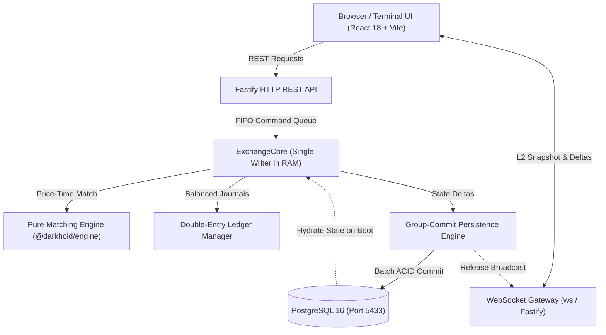

# THE DARKHOLD EXCHANGE (WEBSTER 2026 // Problem H1)

> High-Frequency Secondary Marketplace, In-Memory Limit Order Book, Double-Entry Financial Ledger, and Provable Anti-Bot Protection.

---

## 1. Problem Overview & Persona
Predatory scalpers and automated bot swarms routinely corner secondary ticket marketplaces, driving up prices through artificial scarcity. **The Darkhold Exchange** provides a high-throughput, provably fair trading engine featuring:
- In-memory Price-Time Priority (FIFO) Limit Order Book with sub-microsecond execution.
- Dynamic Anti-Scalping Price Collars tied authoritatively to original face value.
- Append-Only Double-Entry Ledger with zero balance anomalies.
- Automated Dutch Auctions for transparent liquidation.
- Cryptographic Proof of Solvency via Merkle Sum Trees.
- Adaptive Proof-of-Work (PoW) and token-bucket bot defenses.

---

## 2. Architecture & Data Flow



---

## 3. Order Book Matching Algorithm & Complexity

The matching engine in `packages/engine` is pure, synchronous, and 100% deterministic (zero I/O, zero `Date.now()`, zero `Math.random()`).

### Complexity Analysis
| Operation | Implementation Structure | Time Complexity | Note |
| :--- | :--- | :--- | :--- |
| **Submit Limit (Resting)** | Level FIFO list + binary search sorted price array | $O(1)$ amortized insert, $O(\log P)$ search, $O(P)$ array splice for new level | Confirmed by `bench:engine` |
| **Order Cancel** | Node reference in Doubly-Linked List | $O(1)$ | Direct pointer unlink |
| **Best Price Lookup** | Head of sorted price arrays (`bids[0]`, `asks[0]`) | $O(1)$ | Instant memory index |
| **Matching Walk** | Walk opposite price levels and FIFO queue | $O(M)$ | $M$ = number of matched order fills |
| **L2 Depth Aggregation** | Scan top $K$ levels from sorted arrays | $O(K)$ | Top 20 levels aggregated in $<10\,\mu\text{s}$ |

---

## 4. Single-Writer & Group-Commit Persistence

1. **Single Writer with PostgreSQL Advisory Lock:**
   One Node.js process owns in-memory state. Boot enforces exclusive access via `SELECT pg_try_advisory_lock(0x4441524b)`. A second replica will refuse to start.
2. **Group-Commit Batching:**
   Commands execute in RAM in microseconds, producing a delta set. The persistence layer batches up to 100 deltas (or waits at most 5ms) and commits them in **one PostgreSQL transaction**.
3. **Rollback-by-Rebuild:**
   If a PostgreSQL transaction fails, the core halts processing, rejects all commands in that batch, completely rebuilds in-memory state from PostgreSQL, and resumes.

---

## 5. Monetary Arithmetic & Double-Entry Ledger

- **Currency:** Darkhold Credits (DKC). 1 DKC = 100 integer minor units. Floats are prohibited in matching, reservations, and ledger state.
- **Anti-Scalping Collar:**
  $$\text{ceiling} = \left\lfloor \frac{\text{face\_value} \times (10000 + \text{collar\_bps})}{10000} \right\rfloor$$
- **Double-Entry Equilibrium:**
  Every financial transition generates a journal where:
  $$\sum \text{amount} = 0 \quad \text{per unit}$$
  Enforced in application code and by PostgreSQL triggers `trg_postings_immutable` and `trg_journal_balanced`.

---

## 6. Proof of Solvency (Merkle Sum Tree)

Users verify that their balances are included in reported exchange liabilities without revealing private balances:
1. **Leaf:** $\text{SHA256}(0x00 \parallel \text{len}(\text{pseudonym}) \parallel \text{pseudonym} \parallel \text{balance}_{8B})$
2. **Internal Node:** $\text{SHA256}(0x01 \parallel \text{leftHash}_{32B} \parallel \text{leftSum}_{8B} \parallel \text{rightHash}_{32B} \parallel \text{rightSum}_{8B})$
3. **Verification:** Executed client-side in the browser via `@darkhold/shared`.

---

## 7. Benchmark Telemetry Results

<!-- BENCH:START -->

### Measured Benchmark Performance

#### 1. In-Process Matching Engine Benchmark (`bench:engine`)
- **Throughput:** 519,901 orders/sec
- **p50 Latency:** 0.66 µs
- **p95 Latency:** 1.97 µs
- **p99 Latency:** 3.21 µs
- **Total Orders / Trades:** 50,000 / 28,932

#### 2. ExchangeCore with AOL + Group-Commit Persistence Benchmark (`bench:core`)
- **Throughput (AOL Ack):** 185,784 orders/sec (5,000 orders in 26.91 ms)
- **Flush Duration:** 11.96 ms total (6 SQL queries via RAM coalescing & fast-path UNNEST)
- **Post-Benchmark Ledger Reconciliation:** CLEAN (100% Balanced, 0 invariant errors)

#### 3. Public API & Market Data Load Benchmark (`bench:load:market` - k6)
- **Traffic Profile:** 20 Concurrent VUs over 25 seconds
- **Total Requests / Throughput:** 13,220 requests (527.99 req/sec)
- **p95 Latency:** 4.96 ms (Pass criteria: < 50.0 ms)
- **Error Rate:** 0.00% (Pass criteria: < 1.00%)

#### 4. Auth & Wallet Session Lifecycle Load Benchmark (`bench:load:auth` - k6)
- **Traffic Profile:** 10 Concurrent VUs over 25 seconds
- **Total Requests / Throughput:** 2,085 requests (83.04 req/sec)
- **p95 Latency:** 96.49 ms (Pass criteria: < 150.0 ms)
- **Error Rate:** 0.00% (Pass criteria: < 1.00%)

<!-- BENCH:END -->

---

## 8. Quickstart Runbook (WSL 2 Ubuntu)

```bash
# 1. Start PostgreSQL 16 (Port 5433) & Redis 7.4 (Port 6379)
pnpm db:up

# 2. Run Database Migrations
pnpm db:migrate

# 3. Seed Catalogue & Initial Demo Accounts
pnpm db:seed

# 4. Run Test Suite (Shared, Engine, Server integration & failure paths)
pnpm test

# 5. Run Health Check Probes
curl -i http://localhost:3000/health
curl -i http://localhost:3000/ready

# 6. Start Full-Stack Development (Server on :3000, Web Terminal on :5173)
pnpm dev

# 7. Run Load Benchmark Suites
pnpm bench:load:market
pnpm bench:load:auth
```

### Seed Demo Accounts
| Account | Username | Password | Role |
| :--- | :--- | :--- | :--- |
| **Admin** | `admin` | `admin_darkhold_2026` | Exchange Administrator |
| **Alice** | `alice` | `demo_darkhold_2026` | Retail Trader |
| **Bob** | `bob` | `demo_darkhold_2026` | Retail Trader |
| **Carol** | `carol` | `demo_darkhold_2026` | Retail Trader |

---

## 9. Tool Disclosure & Known Limitations

- **Libraries & Frameworks:** Node.js 24, TypeScript 5.6, Fastify v5, `@fastify/websocket`, `@fastify/cookie`, `@node-rs/argon2`, `pg`, `zod`, `vitest`, `react` 18, `vite` 5.
- **AI Assistance:** AI assistance was used for initial architectural drafting, test scaffolding, and performance benchmarking scripts under team review.
- **Known Limitations:**
  - Single-writer architecture requires manual symbol sharding to scale horizontally across multiple database servers.
  - Darkhold Credits (DKC) is a demonstration simulated currency. Proof of solvency proves internal ledger consistency only, not custody of external fiat bank reserves.
